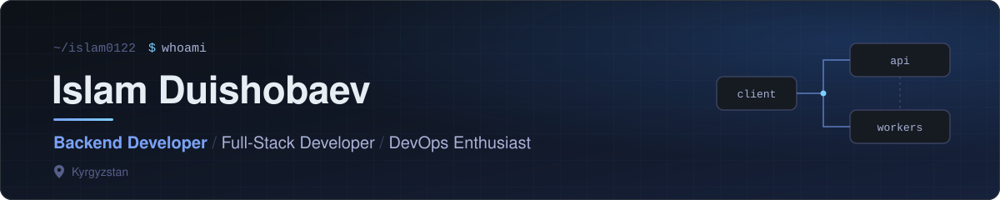

 

 

 

## About

I am a backend developer from Kyrgyzstan. Most of my work happens on the server side: designing data models, building REST APIs, and moving slow work into background jobs so the product stays fast. I also work across the stack when a project needs it, from React interfaces to Docker-based deployments.

**What I build**

- REST APIs and service layers with Django, Django REST Framework and FastAPI
- Asynchronous pipelines with Celery and Redis: grading, reporting, notifications
- Telegram bots with Aiogram, integrated with backend services
- Analytics and admin tooling for educational platforms
- Frontends in React and TypeScript when the product needs one end to end

**Currently focused on**

- Backend architecture and system design
- Docker, CI/CD with GitHub Actions, and production deployments
- Writing code that is tested, observable and easy to hand over

**How I work**

Clear boundaries, boring infrastructure, measured performance. I prefer a simple design that is easy to change over a clever one that is hard to read, and I treat consistency as a skill to practise, not a mood to wait for.

 

## Technology Stack

<table>
  <tr>
    <td width="170"><b>Languages</b></td>
    <td></td>
  </tr>
  <tr>
    <td><b>Backend</b></td>
    <td>
       
      <code>Django REST Framework</code> <code>Celery</code> <code>Aiogram</code>
    </td>
  </tr>
  <tr>
    <td><b>Frontend</b></td>
    <td></td>
  </tr>
  <tr>
    <td><b>Databases</b></td>
    <td></td>
  </tr>
  <tr>
    <td><b>DevOps</b></td>
    <td></td>
  </tr>
  <tr>
    <td><b>Tools</b></td>
    <td></td>
  </tr>
</table>

 

## Featured Projects

### [OkurmenKIDS](https://github.com/Islam0122/OkurmenKIDS)

Educational testing and analytics platform, organised as a monorepo with `backend`, `frontend` and `training-portal` applications.

- Exam and quiz flow with session validation and an adaptive question-selection algorithm
- Celery pipelines for AI-assisted answer grading and Telegram session reports
- Teacher KPI analytics with an ORM-optimised service layer and CSV / Excel export
- Admin workflows for manual grading and review dashboards

<code>Django</code> <code>Django REST Framework</code> <code>Celery</code> <code>Redis</code> <code>React</code> <code>Vite</code> <code>Redux Toolkit</code>
&nbsp;·&nbsp; <a href="https://okurmen-kids-drab.vercel.app">Live</a>

### [Kyrgyzstan Geography Explorer](https://github.com/Islam0122/kyrgyzstan-geography-explorer)

Interactive digital atlas and learning platform on the geography of the Kyrgyz Republic, in Russian and Kyrgyz.

- Leaflet maps with thematic layers and a Three.js 3D relief model built from elevation data
- Climate charts for 14 weather stations, plus water, vegetation and forest sections
- Quiz module with five question types and progress tracking with levels and a printable certificate
- Data from Natural Earth, AWS Terrain Tiles, NOAA GHCN-Daily and Wikimedia Commons

<code>React 19</code> <code>TypeScript</code> <code>Vite</code> <code>Tailwind CSS 4</code> <code>Leaflet</code> <code>Three.js</code> <code>Recharts</code> <code>Zustand</code>
&nbsp;·&nbsp; <a href="https://kyrgyzstan-geography-explorer.vercel.app">Live</a>

### [School 21 Covers](https://github.com/Islam0122/school21-covers)

Client-side generator of student work covers: keeps the original template design and fills in the student's name, class and academic year.

- Canvas rendering with export to a 2174 × 3072 PNG or an A4 Word document
- Python tooling (Pillow, NumPy, OpenCV) to rebuild the template image
- No backend: runs entirely in the browser and deploys as a static site

<code>React</code> <code>Vite</code> <code>JavaScript</code> <code>Canvas API</code> <code>Python</code>
&nbsp;·&nbsp; <a href="https://school21-covers.vercel.app">Live</a>

 

## GitHub Analytics

 

## Contribution Snake

  <picture>
    <source media="(prefers-color-scheme: dark)" srcset="https://raw.githubusercontent.com/Islam0122/islam0122/output/github-snake-dark.svg" />
    <source media="(prefers-color-scheme: light)" srcset="https://raw.githubusercontent.com/Islam0122/islam0122/output/github-snake.svg" />
    
  </picture>
  Regenerated daily by GitHub Actions from the public contribution calendar.

 

## 365 Days of Code

A year of deliberate practice. The goal is not a streak for its own sake; it is to become a measurably better engineer every week.

| Area | Target |
| :--- | :--- |
| Consistency | 365 days of learning and building |
| Projects | 12 meaningful, documented projects |
| Open source | 50 contributions to other projects |
| Architecture | Clean service layers, clear domain boundaries |
| System design | Caching, queues, scaling and failure modes |
| DevOps | Docker and CI/CD in every new project |
| Delivery | Production-ready applications, tested and deployed |

**Checkpoints**

- [ ] 12 projects shipped
- [ ] 50 open-source contributions merged
- [ ] Every new project containerised with a CI pipeline
- [ ] A system design write-up for each major project

Progress is tracked by the public contribution graph above, not by self-reported numbers.

 

## Connect

<!--
  Add more links here once you have the exact URLs, for example:
  
  
-->

 

